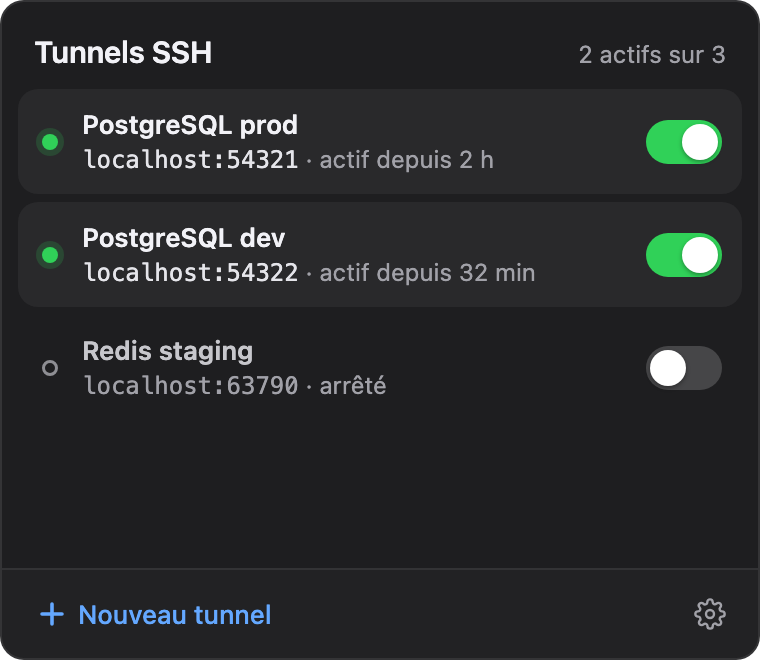
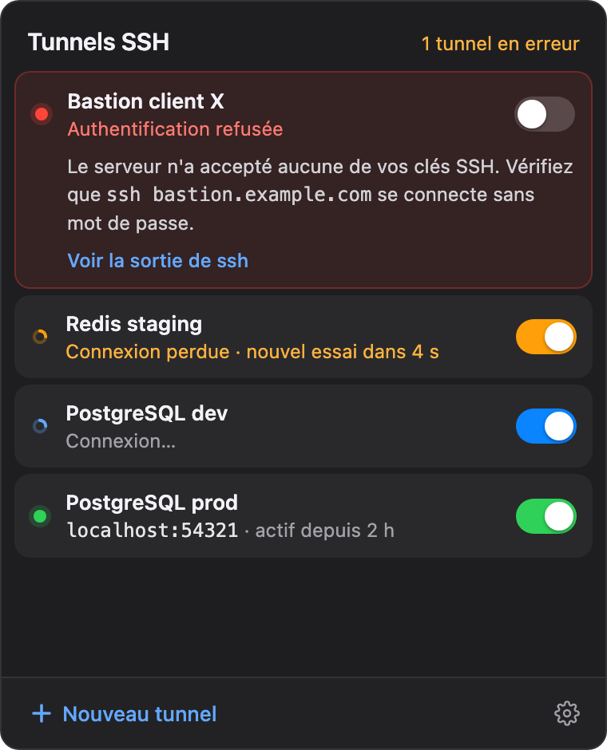
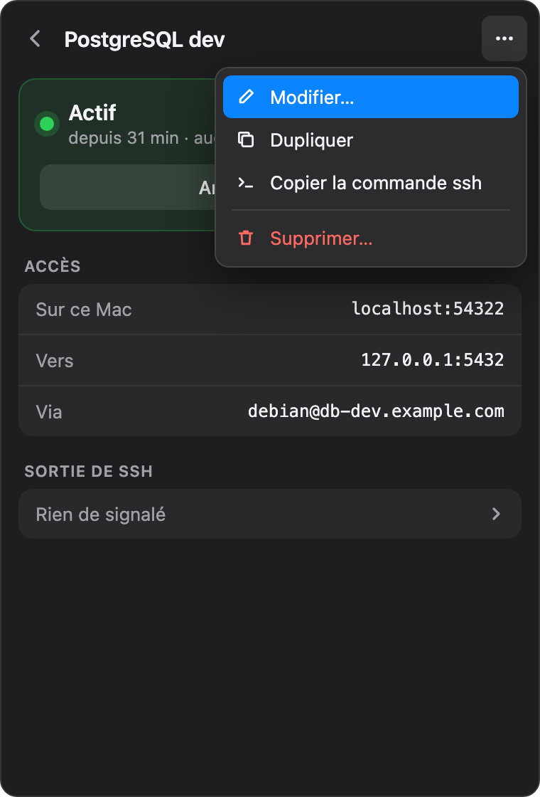
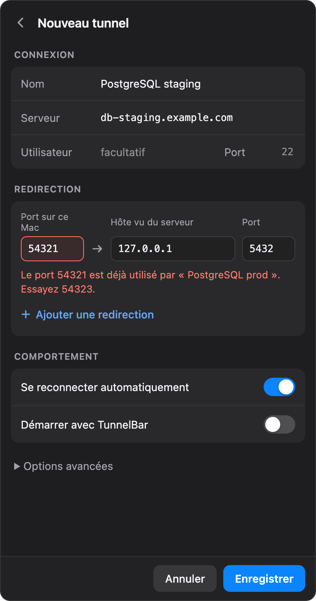

# TunnelBar

> 🇬🇧 [Read in English](README.md)

[](https://github.com/gduprez/tunnelbar/actions/workflows/ci.yml)

Une application de barre de menus macOS pour démarrer, arrêter et surveiller
des tunnels SSH.

TunnelBar vit à côté de l'heure. Un clic affiche vos tunnels et leur état ; un
interrupteur démarre ou arrête chacun d'eux. Il les reconnecte après une mise en
veille ou un changement de réseau, et vous dit en clair pourquoi l'un échoue.

<table>
  <tr>
    <td align="center" valign="top"><br><sub><b>Vos tunnels d'un coup d'œil</b><br>adresse locale, durée, un interrupteur chacun</sub></td>
    <td align="center" valign="top"><br><sub><b>Chaque état est visible</b><br>les erreurs expliquées là où elles surviennent</sub></td>
  </tr>
  <tr>
    <td align="center" valign="top"><br><sub><b>Détail d'un tunnel</b><br>accès, sortie de ssh, menu d'actions</sub></td>
    <td align="center" valign="top"><br><sub><b>Une saisie guidée</b><br>conflits de port nommés, port libre suggéré</sub></td>
  </tr>
</table>

<sub>Maquettes issues de la refonte de l'interface (données d'exemple) ; l'app
suit aussi le thème clair de macOS.</sub>

## Fonctionnalités

- Un clic dans la barre de menus pour démarrer ou arrêter un tunnel comme
  `ssh -L 54321:127.0.0.1:5432 mon-serveur -N`.
- État de chaque tunnel en direct, reconnexion automatique après une mise en
  veille ou une perte de réseau, notification quand un tunnel tombe pour de bon.
- Redirections locales (`-L`), distantes (`-R`) et SOCKS (`-D`), plusieurs par
  connexion.
- Utilise le `ssh` du système : votre `~/.ssh/config`, vos clés et votre agent
  fonctionnent tels quels.
- Messages d'erreur clairs et traduits, sortie de `ssh` à portée de main.
- Anglais et français ; ajouter une langue revient à ajouter un fichier.

## Installation

```sh
brew install --cask gduprez/tap/tunnelbar
```

Ou téléchargez le `.dmg` depuis les [releases](https://github.com/gduprez/tunnelbar/releases).
TunnelBar n'est pas encore notarisé par Apple : voir le
[guide d'utilisation](docs/fr/user-guide.md#installation) pour le premier lancement.

## Prérequis

- macOS 13 Ventura ou plus récent
- Authentification SSH par clé (aucune saisie de mot de passe)

## Compiler depuis les sources

Prérequis : Rust (stable), Node.js 24 (voir `.nvmrc`), outils en ligne de
commande Xcode.

```sh
npm ci
npm run tauri dev      # lancer en mode développement
npm run tauri build    # construire TunnelBar.app et un .dmg
```

Contrôles exécutés par la CI :

```sh
cargo fmt --all --check
cargo clippy --workspace --all-targets -- -D warnings
cargo nextest run --workspace
cargo llvm-cov -p tunnelbar-core --fail-under-lines 85
cargo deny check
npm run format:check && npm run lint && npm run check && npm test
```

## Documentation

- [Guide d'utilisation](docs/fr/user-guide.md)
- [Référence de la configuration](docs/fr/configuration.md)
- [Contribuer](CONTRIBUTING.fr.md)
- [Document de conception](docs/fr/design.md)

## Licence

Distribué au choix sous [licence Apache, version 2.0](LICENSE-APACHE) ou
[licence MIT](LICENSE-MIT).

Sauf mention explicite contraire de votre part, toute contribution que vous
soumettez intentionnellement pour inclusion dans TunnelBar, au sens de la
licence Apache-2.0, est distribuée sous cette double licence, sans conditions
supplémentaires.
